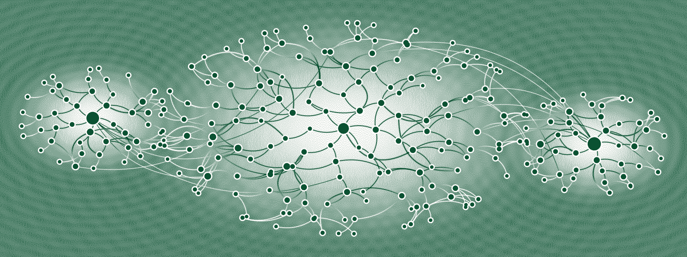
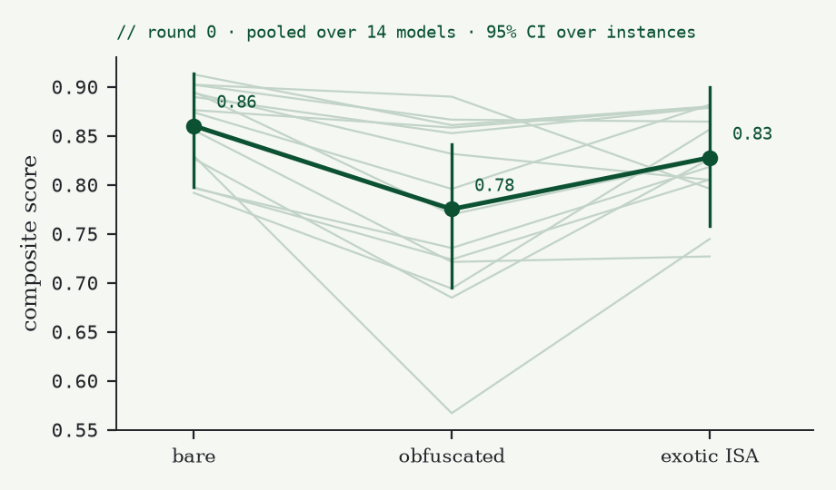
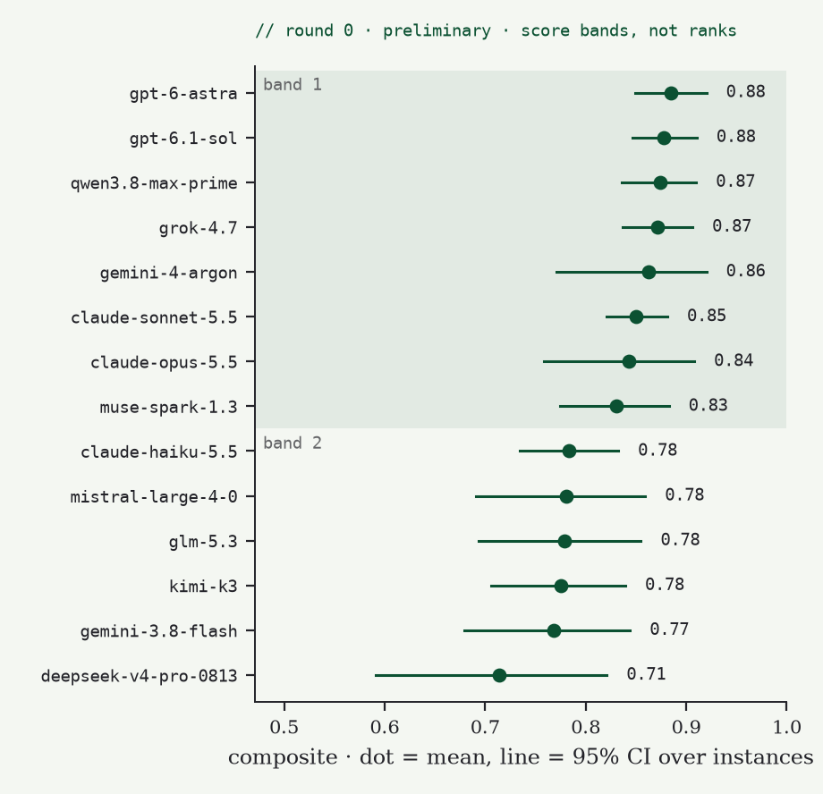
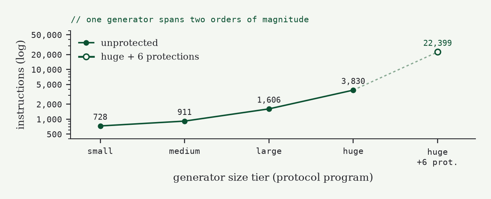
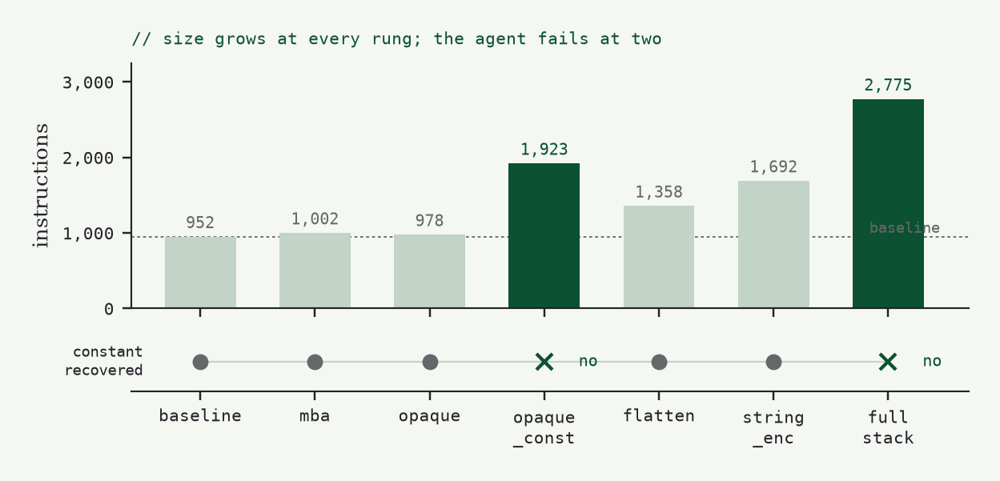
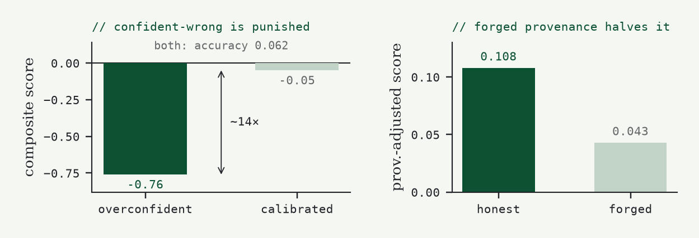
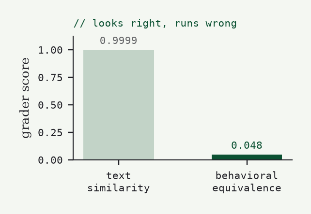
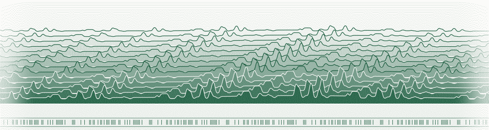

<p align="center"><sub><code>benchmark · reverse engineering · LLM agents · Flock Capital Research</code></sub></p>

<h1 align="center">RETROGRADE</h1>

<p align="center"><em>A procedurally generated, behaviorally graded,<br/>provenance-aware benchmark for reverse-engineering agents.</em></p>

<p align="center"></p>
<p align="center"><sub><code>control-flow · seed 0xC0DE · floyd–steinberg error diffusion</code></sub></p>

<p align="center"><b><a href="paper/RETROGRADE.pdf">Read the paper (PDF, methods)</a></b></p>

---

> **Preliminary results · Round 0.** This is a reduced preview of the full design: 14 frontier
> models (gemini-4-argon added late, see [integrity notes](#late-addition-gemini-4-argon)), 24 episodes each (8 workloads × 3 protection tiers, one seed each), with every model
> served by its maker's own API. It is **a preview, not a ranking**. The full pre-registered round
> (5 seeds × 2 samples per cell) is still to come.
>
> **The paper** ([`paper/RETROGRADE.pdf`](paper/RETROGRADE.pdf)) is a methods paper. It describes
> the generator, the grading, the evaluation protocol and the reporting plan. Model results are
> published here, not in the paper.

## Preliminary results · Round 0

### Obfuscation lowers every model's score

<p align="center"></p>
<p align="center"><sub><b>Figure R1.</b> Composite score by protection tier. The dark line pools all 14 models;
the faint lines are individual models. Bars are 95% bootstrap intervals over instances.</sub></p>

Every one of the 14 models scores lower on the obfuscated build than on the unprotected build of the
same programs (**14 of 14**, one-sided sign test p = 0.00006). The median drop is 0.07 and the range is
0.01 to 0.26. Pooled over models, the score goes from **0.86** (bare) to **0.78** (obfuscated). Moving the
same workloads to an unfamiliar instruction set costs less: the pooled score is **0.83**, and 9 of 14
models score lower there than on bare. With 8 instances per tier the pooled intervals overlap. The
paired 14-of-14 result is the robust finding. (Without the late addition it is 13 of 13, p = 0.0001.)

### Score bands

<p align="center"></p>
<p align="center"><sub><b>Figure R2.</b> Mean composite per model, with 95% bootstrap intervals over its 24 instances.
Read down from the top: a model stays in the current band while its upper bound reaches the
lower bound of the band's first model; the first model that falls short starts a new band.
Within a band the order is not meaningful.</sub></p>

| band | models (composite) |
|---|---|
| **1** | gpt-6-astra (0.88) · gpt-6.1-sol (0.88) · qwen3.8-max-prime (0.87) · grok-4.7 (0.87) · gemini-4-argon† (0.86) · claude-sonnet-5.5 (0.85) · claude-opus-5.5 (0.84) · muse-spark-1.3 (0.83) |
| **2** | claude-haiku-5.5 (0.78) · mistral-large-4-0 (0.78) · glm-5.3 (0.78) · kimi-k3 (0.78) · gemini-3.8-flash (0.77) · deepseek-v4-pro-0813 (0.71) |

† Late addition, run after the round key was revealed; see [below](#late-addition-gemini-4-argon).

The full table, with intervals and per-tier columns, is in
[`results/round0/leaderboard.md`](results/round0/leaderboard.md). Per-tier numbers are 8 episodes per
model and are only indicative. We do not report per-model numbers for individual workloads (n = 3).

### How it was run

- **Same conditions for every model:**
  - the same prompts and tools;
  - 30 tool-calling rounds and 90 tool calls per episode;
  - a 30-minute wall clock;
  - high reasoning effort, and each provider's default sampling.
- **Each model served only by its maker's API.** All 5,832 calls were checked against this.
- **Composite score is calibration-weighted.** A confidently wrong claim scores below zero, and a
  correct answer without a valid justification earns only partial credit.

### Verify the draw

The seed set was fixed by a private round key. Its commitment was published here before the first
episode (commit [`f92f6ac`](https://github.com/flockcap/retrograde-bench/commit/f92f6ac),
2026-10-31 17:40 PDT). The key is revealed now:

```text
commitment  9251359827da55cab55c4c66bed9fff0d6be8c1b331a55be87c155eb88d4c9dd
key         f7e8cded39fc8895ab6bc2746c508d89ba58f983c08f2eaf19c28efca59f8ffc
check       sha256("retrograde-round-commit/" + key) == commitment
```

```bash
printf 'retrograde-round-commit/%s' f7e8cded39fc8895ab6bc2746c508d89ba58f983c08f2eaf19c28efca59f8ffc | shasum -a 256
```

### Integrity notes

Before publishing, we audited all 312 episodes of the original 13 models. Our harness, not the
models, had caused failures in **48 episodes**. We re-ran them; we did not score them.

- **Gemini submissions garbled (24 episodes).** Google's function calling cannot carry a free-form
  object argument, so Gemini's submissions arrived garbled or empty. Its submit argument is now sent
  as a JSON string.
- **Final turn ended empty (15 episodes).** Some providers refuse a forced tool call, and on those
  providers the forced final turn could end with no answer. The model now gets one more turn to give
  its answer as plain text.
- **Full disk (8 episodes).** The sandbox host's disk filled for about 20 minutes during a re-run.
  Tool commands failed in 7 episodes, and grading failed in 1.
- **Stray quote (1 episode).** One submission ended with a stray closing quote, so the parser
  rejected all of its answers. The parser now ignores surplus closing brackets and quotes.
- **During the re-runs**, two provider quirks broke the new plain-text turn: one provider rejected a
  request parameter, and another rejected an empty message turn. Both are fixed, and the affected
  episodes were run again.

**Selection rule.** Episodes were selected for re-run by rule: every Gemini episode, every episode
that ended at the step limit without a submission, every transcript containing the disk error, and
every infrastructure error. Selection never depended on the score.

**Harness revisions.** Each episode records the exact harness revision it ran on:

| revision | episodes |
|---|---|
| `round0-run` | 273 |
| `round0-rerun` | 7 |
| `round0-rerun3` | 23 |
| `round0-rerun4` | 9 |
| `round0-argon` | 24 |

The fixes only change behaviour on the failure paths above. The first four revisions share one
configuration hash. `round0-argon` runs the same harness code as `round0-rerun4`; its configuration
differs only by the two lines that add gemini-4-argon to the roster, so its hash differs.

**Episodes with no answer (4).** In four episodes, all on the obfuscated dsp or transform instances,
the model never produced an answer. Every reply, including the extra plain-text turn, used the full
16,384-token completion budget on reasoning. That budget is the same for all models, so these count
as genuine results.

#### Late addition: gemini-4-argon

gemini-4-argon was added on 2026-11-01, after the results above were published and the round key
was revealed. It ran on the same 24 instances with the same settings and the same harness. Because
the key was already public, its draw was not blind: anyone could have regenerated these instances
first. We consider contamination within one day implausible, but its result does not carry the same
guarantee as the other 13. It is marked † in the band table above.

**Safety blocks.** Google's own API stopped 4 of its 24 episodes partway through with
`403 SAFETY (content_policy_violation)`. These are ordinary reverse-engineering tasks, and no other
model was ever blocked. Our rule: a blocked episode is re-run once, and an episode blocked again
counts as a refusal and scores 0. It is not dropped. Three re-runs completed normally. One (dsp on
the exotic instruction set) was blocked again at the same step and scores 0. Without that rule
gemini-4-argon would average 0.90 over 23 episodes. The audit passes with that one refusal listed.

**Download.** All transcripts, trajectories and submissions, including the quarantined originals
(and gemini-4-argon's four blocked first attempts), are in [`results/round0/round0-artifacts.tar.gz`](results/round0/round0-artifacts.tar.gz).

## Abstract

Reverse-engineering benchmarks for LLM agents are usually **static, hand-built and
contaminating**. Once a fixed corpus of targets is published, it leaks into leaderboards and training
data. These benchmarks are scored by flag-match or text similarity, which rewards pattern-matching over understanding.
RETROGRADE replaces the corpus with a **generator**. Every target is synthesized from a
compositional behavior grammar. It is unique, it never existed as source text, and it ships with
machine-readable ground truth emitted *by construction*. A claim about a binary is graded by
**executing** it: differential testing against a reference oracle, output prediction on
adversarial inputs, and causal interventions verified in an emulator. It is never graded by string similarity.
Every claim carries a confidence and a provenance pointer, scored with a proper scoring rule
and asymmetric loss. That way a confident wrong answer about a safety-relevant fact costs more than an
honest "I don't know". Because targets are generated, the benchmark renews itself: every round
draws fresh, unseen seeds.

## §1 What an agent faces

The agent gets a stripped binary and nothing else. In the default *blind* setting, it isn't told the
workload, the seed, the language or, for re-hosted targets, the instruction set. It works in a
network-isolated sandbox with real tools (disassemblers, a debugger, emulators, Python) under a fixed budget
of tool-calling rounds. It then submits structured claims, each with a confidence and an address that justifies it.

| | |
|---|---|
| **Workloads** | 15 logic archetypes: wire protocols with CRCs and state machines, a randomized bytecode VM, obfuscated arithmetic transforms, container formats, a license-key validator, fixed-point sensor and DSP signal paths, save-file and config parsers, a template renderer, an HDLC/X.25 link layer, an automotive ECU (CAN + UDS), a BLDC motor controller, an expression interpreter, and a **benign** malware-behavior surrogate |
| **Targets** | native aarch64 Linux ELFs compiled from one IR to **C, C++, Rust or Go**; any workload can also be re-hosted on **four bare-metal ISAs** (Cortex-M, RISC-V RV32, PowerPC e500, MSP430) or the **Hexagon** DSP |
| **Protections** | a composable lattice of 10 passes: mixed boolean-arithmetic, opaque predicates, optimizer-robust constant hiding, control-flow flattening, string encryption, anti-debug, virtualization, packing, off-ABI calling conventions and an optimization sweep. All of them preserve behavior, and that is checked on every instance |
| **Tasks** | structure recovery · output prediction · counterfactual intervention · trigger discovery · behavior reconstruction · provenance |

## §2 Five design commitments

1. **Contamination-proof by construction, not by secrecy of a corpus.** There is no corpus to
   memorize. Each round draws fresh seeds from a private key, and the published commitment pins the
   draw in advance.
2. **Behavioral grading, never text match.** Reconstructions are differential-tested against the
   oracle. Predictions are checked by running the target. Trigger claims count only if the guarded
   block actually executes on the agent's input.
3. **Calibration and provenance.** A Brier-style proper scoring rule with asymmetric loss, plus a
   provenance discount: correct answers with bogus justification earn a fraction of the credit.
4. **A debugger and emulator in the loop**, and one fixed program measured under each protection, so
   the capability drop per protection is a clean ablation.
5. **Self-renewing.** Fresh rounds, item difficulty estimated by IRT, retirement of saturated items, and a canary in every
   target binary to detect leakage into training corpora.

## §3 Design results

These come from the generator and the grader alone, not from model runs.

<p align="center"></p>
<p align="center"><sub><b>Figure 1.</b> Generating 150 fresh seeds per archetype gives 150/150 distinct programs
(145/150 for <code>transform</code>, whose constant space is smaller; the collisions match the expected birthday rate). A
conservative lower bound on the <code>protocol</code> space alone is 5.9 × 10<sup>32</sup>.</sub></p>

<p align="center"></p>
<p align="center"><sub><b>Figure 2.</b> One program, protection varied. The instruction count rises at every rung,
from 952 to 2,775 under the full stack. A disassembly-first agent keeps recovering the magic constant until
optimizer-robust constant hiding removes that lexical anchor.</sub></p>

<p align="center"></p>
<p align="center"><sub><b>Figure 3.</b> Two guessers with the same accuracy (0.062) score −0.76 when overconfident
and −0.05 when calibrated, so bluffing doesn't pay. Correct answers with forged provenance earn 0.043,
versus 0.108 with honest provenance.</sub></p>

<p align="center"></p>
<p align="center"><sub><b>Figure 4.</b> A reconstruction that is textually near-identical to the true source
(similarity 0.9999) but has one flipped comparator scores 0.048 under differential testing. A
text-similarity grader would overscore it by about 0.95.</sub></p>

## §4 Integrity of the evaluation

- **Ground truth never enters the sandbox.** At grade time the grader regenerates every answer from the seed, so
  editing agent-reachable files has no effect.
- **A reward-hacking audit is a CI gate.** Adversarial submissions must earn nothing: forged provenance, output-spoofing
  triggers, overfit reconstructions, tampered ground truth, malformed or non-finite confidences,
  duplicate and unrequested claims.
- **Infrastructure failures are never scored.** A run interrupted by an API error, a context-window
  truncation or a missing key is recorded as an error and re-run, never as a model's result. The
  pilot taught us this: two such harness artifacts were found and quarantined before the official run.
- **One frozen configuration for every model**: identical prompts, tools, step and tool-call budgets,
  wall-clock limit, reasoning effort and service tier. Provider routing excludes heavily quantized hosts,
  and the host that actually served each call is logged.
- **Pre-registered statistics.** Several seeds per archetype and independent samples per instance. 95% bootstrap
  intervals are computed over instances. A model that completes fewer than 95% of its cells is listed but not ranked.
- **Provenance on every number.** Each cell records the harness revision, the sandbox image digest, the configuration
  hash, the round commitment, the provider and the full transcript.

## §5 Safety

The malware tier is a behavioral *simulacrum*. It has the control-flow shape of an arming
sequence and a dormant→armed state machine, but no payload and no network access. "Activation" prints
a token and nothing else happens. Vulnerability tasks ask only for localization, never exploit synthesis. All
target execution is network-isolated, capability-dropped and resource-bounded. The generator is
not published.

## Citation

```bibtex
@misc{retrograde2026,
  title  = {{RETROGRADE}: A Procedurally Generated, Behaviorally Graded,
            Provenance-Aware Benchmark for Reverse-Engineering Agents},
  author = {vmfunc and Lamb Wakefield and {Laura K. (Alula)}},
  note   = {Flock Capital. Methods paper},
  year   = {2026},
  url    = {https://github.com/flockcap/retrograde-bench}
}
```

<sub>Content in this repository (text, figures and, once published, results) is licensed under
[CC BY 4.0](LICENSE). The benchmark generator, harness and grader are not open source.</sub>

<p align="center"></p>
<p align="center"><sub><code>trace · seed 0x7ACE · the ridge is decoded from the bitstream below</code></sub></p>
